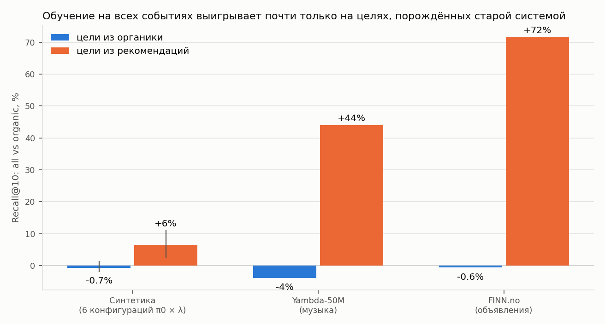

# Копирует ли рекомендательная модель старую систему?

Одностадийные модели учатся на логах, где около половины событий — реакции на рекомендации прежней системы
(в Yambda — 52% прослушиваний). Модель лучше понимает пользователя — или научилась имитировать прежнюю систему?
Проверено на симуляторе и двух реальных датасетах с флагом источника события: **Yambda-50M** (Яндекс Музыка) и
**FINN.no Slates** (объявления, с реальными показами).

**Ответ одинаков на всех трёх стендах:** модель, обученная на всех событиях, выигрывает почти только на целях, которые
породила старая система, а на органическом поведении — так же или чуть хуже. Стандартная офлайн-метрика по всем
событиям этот эффект прячет или выдаёт за улучшение. Лучшая практика — не выбрасывать рекомендованные события,
а понижать их вес (α ≈ 0.25–0.5); IPS проигрывает даже с настоящими пропенсити.



## Метод

Одна и та же модель (SASRec-подобный трансформер) учится на одних и тех же данных с разными весами событий в лоссе:
`all` — все события; `organic` — рекомендованные не являются целями; `alpha-X` — их вес X ∈ {0.25, 0.5};
`all-matched` — все события, урезанные до объёма органики (контроль объёма); `ips-true` / `ips-est` — вес ∝ 1 / пропенсити
показа (по реальным показам / эвристика); `imitator` — только рекомендованные события, приближение старой системы.

Оценка — **раздельно** на органических и рекомендованных целях, плюс прямые меры имитации: сходство выдачи
с имитатором, доля выдачи в реально показанном слейте (FINN.no); на синтетике — качество на истинной полезности
и симулированный онлайн-тест. Значимость — парный бутстрап по пользователям внутри сида.

Симулятор: дискретно-событийный маркетплейс; старая система π0 (`good` — близка к полезности, `skewed` — продвигает
10% товаров) показывает слейты с известной пропенсити; отклик на показ зависит от полезности и от силы давления
показа λ, доля рекомендованных покупок откалибрована на 0.5.

## Результаты

| | Синтетика | Yambda-50M | FINN.no |
|---|---|---|---|
| доля рекомендованных событий | 0.50 | 0.52 | 0.26 |
| `all` vs `organic`: Recall@10 на органике | −0.7% (−1.8…+1.2) | **−3.9%** (значимо) | −0.6% (н/з) |
| `all` vs `organic`: Recall@10 на рекомендованных | +6% (+3…+11) | **+44%** | **+72%** |
| `all` vs `organic`: Recall@10 по всем целям | — | +1.7% (н/з) | **+9.3%** (значимо) |
| сходство с имитатором: `all` / `organic` | выше у `all` во всех конфигурациях | 0.28 / 0.16 | 0.24 / 0.13 |
| лучший вес рекомендованных событий | α = 0.5 | α = 0.25 | α = 0.5 |
| IPS против `all` | хуже | хуже | хуже, и с реальными пропенсити |

**Выводы**

1. **Имитация есть на всех стендах и сильнее всего на реальных логах.** Модель на всех событиях заметно ближе к прежней
   системе, а на FINN.no чаще кладёт в выдачу реально показанные объявления (0.083 против 0.052).
2. **Выигрыш от рекомендованных событий — почти целиком на целях, которые породила прежняя система.**
3. **Метрика по всем событиям прячет это или искажает:** на Yambda `all` ≈ `organic`, на FINN.no `all` «выигрывает» +9% —
   целиком за счёт рекомендованных целей.
4. **Понижать вес, а не выбрасывать:** α ≈ 0.25–0.5 лучше `all` на органике (значимо, оба сида) и не хуже по всем целям.
5. **Объём важен:** на равном объёме рекомендованные события везде менее информативны, чем органические.
6. **IPS исправляет состав выдачи, а не качество.** На симуляторе видно почему: смещение показов (лог повторяет, что
   показывали) и давление показа (покупают показанное без связи с пользой) — разные механизмы; IPS лечит первый,
   вред приносит второй.
7. **Направление popularity bias зависит от данных:** на Yambda рекомендации вносят разнообразие, на FINN.no — наоборот.

**Практические рекомендации:** считать офлайн-метрики раздельно по источнику события; держать в абляциях понижение веса
рекомендованных событий; отслеживать сходство с прежней системой как отдельную метрику; причинный ответ даёт только
онлайн-тест или случайные показы.

**Ограничения:** «органика» — канал, а не поведение без рекомендателя (на FINN.no это поиск); каталоги урезаны до 20 тыс.
(покрывают 55% целей теста на Yambda и 29% на FINN.no); одна небольшая архитектура, 2 сида на реальных данных.
Проверки симулятора дали 5 FAIL из 13 — пороги не подгонялись, разбор и все таблицы по этапам — в [RESULTS.md](RESULTS.md).

## Запуск

```bash
pip install -r requirements.txt
python sanity.py --part data                  # проверки симулятора на данных
python sanity.py --part models                # проверки на моделях
python fl_train.py --policy good skewed --lam 0 0.5 1 --seeds 0 1 2 --out results/sweep   # синтетика
python yambda_train.py                        # Yambda-50M (скачивает данные с Hugging Face)
python finn_train.py                          # FINN.no Slates
```

Полные прогоны — на Kaggle GPU самодостаточными ноутбуками из `kaggle/` (снимок кода в ячейках): синтетика
`feedback_loop_stage2.ipynb` (~3.5 ч), Yambda `feedback_loop_yambda.ipynb` (~2 ч), FINN.no `feedback_loop_finn.ipynb` (~3 ч).
Сырые результаты — `results/`.

## Файлы

`sim.py` — симулятор · `fl_data.py` — сплит и метрики на целях, правде, сходстве · `fl_train.py` — обучение с весами
событий и отчёт · `sanity.py` — проверки с критериями PASS/FAIL · `yambda*.py`, `finn*.py` — реальные стенды ·
`common.py` + `rs_core/` — модель и метрики из [repeat-switch-rec](https://github.com/RepairTheSystem/repeat-switch-rec) ·
[DESIGN.md](DESIGN.md) — дизайн и гипотезы · [RESULTS.md](RESULTS.md) — подробные результаты по этапам.

Данные: [Yambda](https://huggingface.co/datasets/yandex/yambda) (Apache 2.0),
[FINN.no Slates](https://huggingface.co/datasets/simeneide/recsys_slates_dataset) (Apache 2.0).
