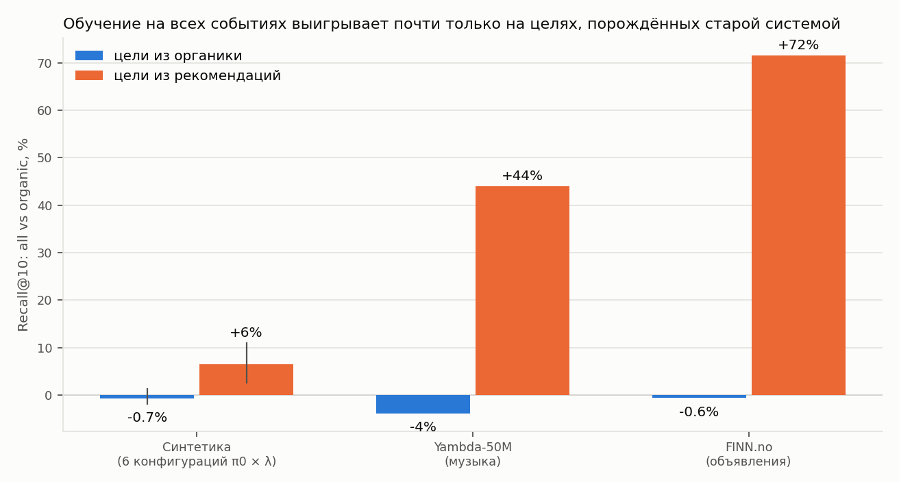

# Копирует ли рекомендательная модель старую систему? Сводка по трём стендам

**Коротко.** Одностадийные рекомендательные модели учатся на логах, где около половины событий — реакции на
рекомендации прежней системы. Я проверил на симуляторе и двух реальных датасетах с флагом источника события
(Yambda — музыка, FINN.no — объявления), что даёт обучение на этих событиях. Ответ одинаков везде: **модель, обученная
на всех событиях, выигрывает почти только на тех целях, которые породила старая система**, а на органическом
поведении — так же или чуть хуже. Стандартная офлайн-метрика по всем событиям этот эффект прячет или выдаёт за
улучшение. Лучшая практика на всех трёх стендах — не выбрасывать рекомендованные события, а понижать их вес
(α ≈ 0.25–0.5); IPS, даже с настоящими пропенсити по показам, проигрывает.

*Recall@10 модели на всех событиях относительно модели только на органике. Синтетика — среднее по 6 конфигурациям
(ус — разброс), Yambda и FINN.no — среднее по 2 сидам. Построено `figures/make_summary_figure.py`.*

## Вопрос

Одностадийные генеративные модели заменяют каскад «кандидаты → ранжирование» одной моделью и выигрывают у него
офлайн и онлайн. Но учатся они на логах платформы, а значительная часть логов — реакции на показы прежней системы
(в Yambda — около половины прослушиваний). Неудобный вопрос: модель лучше понимает пользователя — или научилась
имитировать прежнюю систему?

## Метод

Одна и та же модель (SASRec-подобный трансформер) учится на одних и тех же данных с разными весами событий в лоссе;
на входе она всегда видит полную историю.

| вариант | что делает |
|---|---|
| `all` | все события, как обычно |
| `organic` | рекомендованные события не являются целями обучения |
| `alpha-X` | вес рекомендованных событий X ∈ {0.25, 0.5} |
| `all-matched` | все события, урезанные до объёма органики — **контроль объёма** |
| `ips-true` / `ips-est` | вес ∝ 1 / пропенсити показа: по реальным показам / эвристика по частоте |
| `imitator` | только рекомендованные события — приближение старой системы, для метрики сходства |

Оценка — **раздельно** на органических и рекомендованных целях, плюс прямые меры имитации: сходство выдачи с
имитатором, доля выдачи, попавшая в реально показанный слейт (FINN.no), на синтетике — качество на истинной полезности
и симулированный онлайн-тест. Значимость — парный бутстрап по пользователям внутри сида.

| стенд | что даёт | «органика» | доля рекомендованных |
|---|---|---|---|
| **Синтетика** | известная правда, сила давления показа λ, кривая π0 | известна точно | 0.50 (калибровка) |
| **Yambda-50M** | реальные логи Яндекс Музыки, 29 млн позитивов | флаг `is_organic` | 0.52 |
| **FINN.no Slates** | реальные показы (весь слейт), 3.7 млн кликов | клики из поиска | 0.26 |

## Результаты

| | Синтетика | Yambda-50M | FINN.no |
|---|---|---|---|
| `all` vs `organic`: Recall@10 на органике | −0.7% (−1.8…+1.2) | **−3.9%** (значимо) | −0.6% (н/з) |
| `all` vs `organic`: Recall@10 на рекомендованных | +6% (+3…+11) | **+44%** | **+72%** |
| `all` vs `organic`: Recall@10 по всем целям | — | +1.7% (н/з) | **+9.3%** (значимо) |
| сходство с имитатором: `all` / `organic` | выше у `all` во всех 6 конфигурациях | 0.28 / 0.16 | 0.24 / 0.13 |
| доля выдачи в реально показанном слейте: `all` / `organic` | — | — | 0.083 / 0.052 |
| лучший вес рекомендованных событий | α = 0.5 (при кривой π0) | α = 0.25 | α = 0.5 |
| IPS против `all` | хуже | хуже | хуже, и с реальными пропенсити |

## Выводы

1. **Имитация есть на всех трёх стендах и сильнее всего на реальных логах.** Модель на всех событиях заметно ближе
   к прежней системе — по сходству с имитатором и, на FINN.no, по доле реально показанных объявлений в своей выдаче.
2. **Выигрыш от рекомендованных событий почти целиком — на целях, которые породила прежняя система.** На органике
   качество то же (FINN.no, синтетика) или ниже (Yambda: −4% в топ-10).
3. **Стандартная метрика по всем событиям прячет это или искажает.** На Yambda `all` и `organic` по ней равны —
   выигрыш и проигрыш гасятся. На FINN.no `all` по ней *выигрывает* (+9%), и весь этот выигрыш — из рекомендованных
   целей. Без разбивки по источнику события «лучше имитирует» неотличимо от «лучше понимает пользователя».
4. **Лучшая практика — понижать вес, а не выбрасывать.** На обоих реальных стендах α ≈ 0.25–0.5 лучше `all` на
   органике (значимо, оба сида) и не хуже по всем целям; на синтетике α = 0.5 лучше `all` на истинной полезности при
   кривой π0 и не хуже при хорошей. Выбросить рекомендованные события целиком хуже: они несут сигнал (на Yambda
   `organic` проигрывает на @100, на синтетике с хорошей π0 — на правде).
5. **Объём важен.** На равном объёме рекомендованные события везде менее информативны, чем органические: выигрыш
   `all` — во многом от вдвое большего лога.
6. **IPS исправляет состав выдачи, а не качество.** Он снижает популярность и расширяет покрытие, но проигрывает по
   Recall на всех стендах — в том числе с настоящими пропенсити по реальным показам (FINN.no). На симуляторе удалось
   объяснить почему: смещение показов (лог повторяет, что показывали) и давление показа (покупают показанное без
   связи с пользой) — разные механизмы; IPS лечит первый, вред приносит второй.
7. **Неожиданное: направление popularity bias зависит от данных.** На Yambda рекомендации вносят разнообразие
   (модель на органике выдаёт более популярное), на FINN.no — наоборот. Гипотеза «имитируются в основном повторы»
   не подтвердилась: рекомендованное везде *менее* повторное, чем органическое.

**Практические рекомендации** для команды, обучающей модель на логах с рекомендациями:
(1) всегда считать офлайн-метрики раздельно по источнику события; (2) держать в абляциях понижение веса
рекомендованных событий (α = 0.25–0.5) — на наших стендах оно не стоило ничего по общей метрике;
(3) отслеживать сходство с прежней системой как отдельную метрику; (4) причинный ответ даёт только онлайн-тест
или случайные показы — офлайн отвечает на вопрос в пределах приближения «органика ≈ предпочтения».

## Что пошло не так по ходу и чему это научило

- **Проверки на вменяемость симулятора дали 5 FAIL из 13.** Подгонять пороги я не стал; разбор показал, что неверны были
  ожидания, а не код, — и из него вырос главный методический вывод (два механизма, п. 6).
- **Ошибка единиц времени в загрузчике Yambda.** Метка времени — секунды, округлённые до 5 с, а я считал её числом
  5-секундных интервалов; тестовый «день» оказался 4.8 часа. Поймал по длительности датасета (1504 дня вместо ~301),
  прогон помечен недействительным, в загрузчик добавлены проверки, которые теперь роняют такой прогон сразу.
- **Имитатор на показах (FINN.no) получился слабым:** верхнее объявление слейта — шумная цель. Прямая мера по всему
  показанному слейту оказалась надёжнее.
- **Ручка давления λ в симуляторе почти не различает способы обучения:** отклик слабо чувствителен к полезности
  (параметр β) — синтетика проверяет механизм, но недооценивает силу эффекта, которую показали реальные данные.

## Ограничения

- **Органика ≠ поведение без рекомендателя.** Флаг разделяет канал, а не причину; на FINN.no «органика» — поиск,
  тоже ранжирующая система. «Лучше на органике» — лучшее доступное офлайн-приближение «лучше понимает пользователя».
- **Каталоги урезаны** (полный softmax не помещается): на Yambda 20 тыс. треков покрывают 55% целей теста, на FINN.no
  20 тыс. объявлений — 29%. Сравнения вариантов корректны, абсолютные значения с другими работами — нет.
- Одна небольшая архитектура; 2 сида на реальных данных (меняют только инициализацию; неопределённость по
  пользователям покрывает бутстрап); отбор эпохи по органической валидации немного подыгрывает органике.
- Стенды отличаются всем сразу — сравнение силы эффекта между ними — сравнение датасетов, а не доменов.

## Что дальше

- Несмещённая проверка на случайных показах (KuaiRand) — ближе всего к причинному ответу без онлайн-теста.
- Полные каталоги через sampled softmax / семантические ID — чтобы оценить хвост.
- Лайки в Yambda как второй тип позитива; π0, переобучаемая на собственных логах (петля в динамике).

## Воспроизведение

Всё считается на Kaggle (GPU T4) самодостаточными ноутбуками из `kaggle/`:
синтетика — `feedback_loop_stage2.ipynb` (~3.5 ч), Yambda — `feedback_loop_yambda.ipynb` (~2 ч),
FINN.no — `feedback_loop_finn.ipynb` (~3 ч). Подробности, все таблицы и проверки — [README.md](README.md),
дизайн и гипотезы — [DESIGN.md](DESIGN.md). Данные: [Yambda](https://huggingface.co/datasets/yandex/yambda)
(Apache 2.0), [FINN.no Slates](https://huggingface.co/datasets/simeneide/recsys_slates_dataset) (Apache 2.0).
